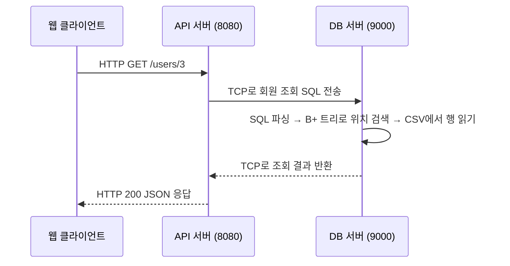

# mini DBMS

## 설치 및 실행

### 실행 환경

- macOS 또는 Linux의 로컬 파일시스템
- Python 3.10 이상 권장. Python 표준 라이브러리만 사용하므로 별도 패키지 설치 없이 실행할 수 있습니다.

프로젝트의 `.py` 파일이 있는 폴더에서 실행하세요. 아래 예제는 `demo-data/`에 데이터를 저장합니다.

실행 순서는 **CLI로 예제 데이터 준비 → DB 서버 시작 → API 서버 시작 → 회원 조회**입니다.

### CLI에서 데이터 저장하고 조회하기

```bash
python3 mini_dbms.py --data-dir demo-data
```

`sql>` 프롬프트에 아래 SQL을 입력하세요. 문장은 여러 줄로 작성할 수 있고, 세미콜론으로 끝냅니다.

```sql
CREATE TABLE users (id PRIMARY KEY, name);

INSERT INTO users (id, name)
VALUES (3, '김철수'), (4, '이영희');

SELECT id, name FROM users WHERE id = 3;
```

`INSERT 2`는 두 행이 저장됐다는 뜻입니다. 위 `SELECT`의 결과는 다음과 같습니다.

```json
{"columns": ["id", "name"], "rows": [[3, "김철수"]]}
```

`Ctrl+D`로 CLI를 종료할 수 있습니다. 같은 예제를 처음부터 다시 실행하려면 다른 데이터 폴더를 지정하세요.

### HTTP로 회원 조회하기

위 예제 데이터를 저장한 뒤, 프로젝트 폴더에서 터미널 두 개를 열어 서버를 시작하세요.

**터미널 1에서 DB 서버 시작**

```bash
python3 db_server.py --data-dir demo-data --workers 4
```

**터미널 2에서 API 서버 시작**

```bash
python3 api_server.py --workers 4
```

두 서버를 실행한 상태에서 브라우저로 [http://127.0.0.1:8080/users/3](http://127.0.0.1:8080/users/3)을 열거나, 세 번째 터미널에서 아래 명령을 실행하세요.

```bash
curl http://127.0.0.1:8080/users/3
```

```json
{"id": 3, "name": "김철수"}
```

| 상태 코드 | 의미 |
| --- | --- |
| `200` | 회원 조회 성공 |
| `400` | 회원 ID가 정수 형식이 아님 |
| `404` | 회원 또는 요청 경로를 찾을 수 없음 |
| `502` | DB 연결이나 조회에 실패함 |
| `504` | DB 연결 또는 응답 대기 시간이 초과됨 |

두 서버는 기본으로 `127.0.0.1`에서 실행됩니다. API 포트는 `8080`, DB 포트는 `9000`입니다. DB 서버의 `--port`를 바꾸면 API 서버에서도 같은 값을 `--db-port`로 지정하세요. `--workers`의 기본값은 서버마다 `4`입니다. API 서버의 DB 소켓 시간 제한은 `--db-timeout`으로 지정하고, 기본값은 5초입니다.

## 프로젝트 소개

Python으로 만든 학습용 파일 기반 DBMS입니다. SQL로 데이터를 CSV에 저장하고, B+ 트리 인덱스로 원하는 행을 찾을 수 있습니다. CLI로 직접 사용하거나, 별도의 HTTP API 서버를 통해 회원 정보를 조회할 수 있습니다.

## 지원하는 SQL과 인덱스

| 명령 | 동작 |
| --- | --- |
| `CREATE TABLE users (id PRIMARY KEY, name);` | 컬럼과 단일 컬럼 기본키를 선언합니다. |
| `INSERT INTO users (id, name) VALUES (5, '박민수');` | 한 행을 저장합니다. `VALUES`에 여러 행을 넣으면 한 묶음으로 저장합니다. |
| `SELECT * FROM users;` | 모든 컬럼을 조회합니다. 컬럼을 지정하거나 `WHERE 컬럼 = 값`으로 필터링할 수 있습니다. |
| `ALTER TABLE users ADD PRIMARY KEY (id);` | 기존 테이블에 기본키를 추가합니다. 기존 값의 중복과 `NULL`을 검사합니다. |
| `CREATE INDEX idx_users_name ON users (name);` | 지정한 컬럼에 B+ 트리 인덱스를 만듭니다. |
| `ALTER TABLE users AUTO_PRIMARY_INDEX OFF;` | 기본키 자동 인덱스를 끕니다. `ON`으로 다시 켤 수 있습니다. |

새 테이블의 기본키 자동 인덱스는 기본값이 `ON`입니다. `OFF`에서도 기본키의 중복과 `NULL`을 검사하고, 수동 인덱스는 계속 사용합니다. `SELECT`의 `WHERE` 컬럼에 인덱스가 있으면 행의 파일 위치를 찾아 읽고, 그 외에는 CSV를 순서대로 읽습니다.

컬럼 이름을 명시한 첫 `INSERT`로 테이블을 만들 수도 있습니다. 기본키를 함께 정하려면 `CREATE TABLE`을 사용하세요.

## 데이터 파일과 복구

| 파일 | 내용 |
| --- | --- |
| `users.csv` | 테이블의 컬럼과 실제 행 |
| `users.schema.json` | 컬럼, 기본키, 인덱스 설정 |
| `users.id.index.csv` | `id` 인덱스의 키와 행의 바이트 위치 |
| `users.journal` | 쓰기 중에 사용하는 복구 기록 |

테이블 CSV를 기준으로 데이터를 관리합니다. 인덱스 CSV에는 키와 위치를 저장하고, 테이블을 열 때 메모리에서 B+ 트리를 구성합니다. 인덱스 파일이 없거나 데이터 파일과 맞지 않으면 테이블 CSV에서 다시 만듭니다.

이전 버전의 JSONL 테이블은 처음 열 때 CSV로 변환되며 원본 파일은 보관합니다.

묶음을 쓰기 전에 저널에 파일 길이와 마지막 영역의 원본을 기록합니다. 저장을 마치기 전에 실행이 중단돼 저널이 남으면, 다음에 그 테이블을 열 때 완료되지 않은 묶음을 되돌리고 인덱스를 다시 만듭니다.

## 서버 구조



- **API 서버**는 HTTP 요청을 SQL로 바꾸고, DB 결과를 JSON으로 응답합니다. 한 워커가 DB 응답을 기다리는 동안 다른 워커는 별도 TCP 연결로 요청을 보낼 수 있습니다.
- **DB 서버**는 SQL을 워커 풀에서 실행합니다. 준비된 테이블의 조회는 공유 락으로 함께 처리하고, 쓰기와 복구는 배타 락을 사용합니다.

TCP 요청과 응답은 `[4바이트 본문 길이, 빅 엔디언][UTF-8 JSON]`으로 전송합니다. 연결 하나에서 요청과 응답 한 쌍을 처리합니다.

| 파일 | 역할 |
| --- | --- |
| [`mini_dbms.py`](mini_dbms.py) | SQL 실행, CSV 저장, CLI |
| [`sql_parser.py`](sql_parser.py) | SQL 문자열을 실행에 필요한 객체로 변환 |
| [`bplus_tree.py`](bplus_tree.py) | B+ 트리 인덱스 |
| [`storage_recovery.py`](storage_recovery.py) | 파일 락과 저널 복구 |
| [`api_server.py`](api_server.py) · [`db_server.py`](db_server.py) | HTTP API와 TCP DB 서버 |
| [`server_transport.py`](server_transport.py) | TCP 메시지 형식과 공용 워커 풀 |

## HTTP 조회 성능

기본 설정인 API 워커 4개와 DB 워커 4개에서 **3,576 request/s**, **응답 시간 중앙값 4.12ms**를 기록했습니다.

- Apple M5, Python 3.13.15, API·DB·클라이언트가 같은 머신에서 실행
- 회원 10만 행, 기본키 B+ 트리 인덱스 `ON`, `GET /users/{id}`로 한 행씩 조회
- 동시 클라이언트 16개, 예열 후 설정마다 12,800건씩 3회 측정
- `POST /users` 추가 전의 조회 구현에서 측정

| API 워커 | DB 워커 | 성공 처리량 (request/s) | 응답 시간 (중앙값) | 실패 / 전체 |
| ---: | ---: | ---: | ---: | ---: |
| 1 | 1 | 2,981 | 4.99ms | 0 / 38,400 |
| 1 | 4 | 2,916 | 5.03ms | 0 / 38,400 |
| 4 | 1 | 1,359 | 3.72ms | 2,805 / 38,400 |
| **4** | **4** | **3,576** | **4.12ms** | **0 / 38,400** |

각 회차에서 초당 성공 응답 수(`request/s`)와 성공 요청의 응답 시간 중앙값을 구한 뒤, 3회 측정의 중앙값을 표에 적었습니다. API와 DB 워커를 각각 1개에서 4개로 늘렸을 때 이 조건에서 처리량이 약 20% 증가했습니다. `4 / 1` 설정에서 발생한 연결 오류와 `502`의 원인은 확인하지 못했습니다.

## 현재 범위

조회 조건은 단일 `=` 비교를 지원합니다. `UPDATE`, `DELETE`, `JOIN`, 서브쿼리와 여러 SQL 문을 묶는 트랜잭션은 현재 지원 범위 밖입니다. HTTP API는 `GET /users/{id}` 조회를 제공합니다.
