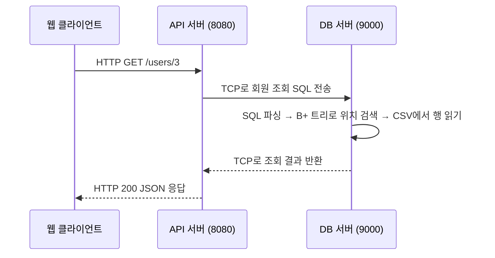

# mini DBMS

파이썬과 HTTP API로 사용하는 가벼운 mini DBMS입니다. 데이터 조회에 B+ 트리 인덱스를 사용합니다.

## 목차

- [설치 및 실행](#설치-및-실행)
  - [설치](#설치)
  - [서버 실행](#서버-실행)
  - [CLI에서 데이터 저장하고 조회하기](#cli에서-데이터-저장하고-조회하기)
  - [HTTP로 회원 조회하기](#http로-회원-조회하기)
- [지원하는 SQL과 인덱스](#지원하는-sql과-인덱스)
- [데이터 파일과 복구](#데이터-파일과-복구)
- [서버 구조](#서버-구조)
- [동시성 정책](#동시성-정책)
- [HTTP 조회 성능](#http-조회-성능)
- [현재 범위](#현재-범위)

## 설치 및 실행

### 요구사항

- macOS 또는 Linux의 로컬 파일시스템
- Python 3 이상 권장. Python 표준 라이브러리만 사용합니다.

### 서버 실행

프로젝트 폴더에서 터미널 두 개를 열어 서버를 시작하세요.

**터미널 1에서 DB 서버 시작**

```bash
python3 db_server.py --data-dir demo-data --workers 4
```

**터미널 2에서 API 서버 시작**

```bash
python3 api_server.py --workers 4
```

두 서버는 기본으로 `127.0.0.1`에서 실행됩니다. API 포트는 `8080`, DB 포트는 `9000`입니다. DB 서버의 `--port`를 바꾸면 API 서버에서도 같은 값을 `--db-port`로 지정하세요. `--workers`로 스레드 수를 지정하며, 기본값은 서버마다 `4`입니다. API 서버의 DB 소켓 시간 제한은 `--db-timeout`으로 지정하고, 기본값은 5초입니다.

### CLI에서 데이터 저장하고 조회하기

1. 프로젝트 폴더에서 CLI를 엽니다. 데이터는 `demo-data/`에 저장됩니다.

   ```bash
   python3 mini_dbms.py --data-dir demo-data
   ```

2. `sql>`에 아래 SQL을 입력합니다. 회원 두 명을 저장하고 3번 회원을 조회합니다.

   ```sql
   CREATE TABLE users (id PRIMARY KEY, name);
   INSERT INTO users (id, name) VALUES (3, '김철수'), (4, '이영희');
   SELECT id, name FROM users WHERE id = 3;
   ```

3. 조회 결과를 확인합니다.

   ```json
   {"columns": ["id", "name"], "rows": [[3, "김철수"]]}
   ```

#### 실행 시 참고

- SQL 문장은 여러 줄로 입력할 수 있으며 세미콜론(`;`)으로 끝냅니다.
- CLI를 종료하려면 `Ctrl+D`를 누릅니다.
- 예제를 다시 실행하려면 `--data-dir`에 새 폴더를 지정합니다.

### HTTP로 회원 조회하기

CLI 예제 데이터를 저장하고 두 서버를 실행한 상태에서 브라우저로 [http://127.0.0.1:8080/users/3](http://127.0.0.1:8080/users/3)을 열거나, 세 번째 터미널에서 아래 명령을 실행하세요.

```bash
curl http://127.0.0.1:8080/users/3
```

```json
{"id": 3, "name": "김철수"}
```

| 상태 코드 | 의미 |
| --- | --- |
| `200` | 회원 조회 성공 |
| `400` | 회원 ID가 정수 형식이 아님 |
| `404` | 회원 또는 요청 경로를 찾을 수 없음 |
| `502` | DB 연결이나 조회에 실패함 |
| `504` | DB 연결 또는 응답 대기 시간이 초과됨 |

## 지원하는 SQL과 인덱스

| 명령 | 동작 |
| --- | --- |
| `CREATE TABLE users (id PRIMARY KEY, name);` | 컬럼과 단일 컬럼 기본키를 선언합니다. |
| `INSERT INTO users (id, name) VALUES (5, '박민수');` | 한 행을 저장합니다. `VALUES`에 여러 행을 넣으면 한 묶음으로 저장합니다. |
| `SELECT * FROM users;` | 모든 컬럼을 조회합니다. 컬럼을 지정하거나 `WHERE 컬럼 = 값`으로 필터링할 수 있습니다. |
| `ALTER TABLE users ADD PRIMARY KEY (id);` | 기존 테이블에 기본키를 추가합니다. 기존 값의 중복과 `NULL`을 검사합니다. |
| `CREATE INDEX idx_users_name ON users (name);` | 지정한 컬럼에 B+ 트리 인덱스를 만듭니다. |
| `ALTER TABLE users AUTO_PRIMARY_INDEX OFF;` | 기본키 자동 인덱스를 끕니다. `ON`으로 다시 켤 수 있습니다. |

새 테이블의 기본키 자동 인덱스는 기본값이 `ON`입니다. `OFF`에서도 기본키의 중복과 `NULL`을 검사하고, 수동 인덱스는 계속 사용합니다. `SELECT`의 `WHERE` 컬럼에 인덱스가 있으면 행의 파일 위치를 찾아 읽고, 그 외에는 CSV를 순서대로 읽습니다.

컬럼 이름을 명시한 첫 `INSERT`로 테이블을 만들 수도 있습니다. 기본키를 함께 정하려면 `CREATE TABLE`을 사용하세요.

## 데이터 파일과 복구

| 파일 | 내용 |
| --- | --- |
| `users.csv` | 테이블의 컬럼과 실제 행 |
| `users.schema.json` | 컬럼, 기본키, 인덱스 설정 |
| `users.id.index.csv` | B+ 트리 정보 |

테이블 CSV에는 실제 데이터를 저장합니다. 인덱스 CSV에는 검색할 값과 해당 행의 위치를 적어 둡니다. 테이블을 열면 이 정보로 메모리에 B+ 트리를 만듭니다. 인덱스 파일이 없거나 테이블 내용과 맞지 않으면 테이블 CSV를 읽어 인덱스를 다시 만듭니다.

## 서버 구조



- **API 서버**는 HTTP 요청을 SQL로 바꾸고, DB 결과를 JSON으로 응답합니다. 한 스레드가 DB 응답을 기다리는 동안 다른 스레드는 별도 TCP 연결로 요청을 보낼 수 있습니다.
- **DB 서버**는 SQL을 스레드 풀에서 실행합니다.

TCP 요청과 응답은 `[4바이트 본문 길이, 빅 엔디언][UTF-8 JSON]`으로 전송합니다. 연결 하나에서 요청과 응답 한 쌍을 처리합니다.

## 동시성 정책

DB 서버와 CLI는 같은 데이터 폴더의 `.mini_dbms.lock` 파일로 읽기와 쓰기 순서를 맞춥니다.

- **조회**는 테이블이 준비되면 공유 락을 잡습니다. 여러 `SELECT`가 동시에 읽을 수 있습니다.
- **쓰기와 복구**는 배타 락을 잡습니다. `INSERT`는 기본키 검사부터 CSV 저장과 인덱스 갱신까지 락을 유지합니다. 그동안 같은 폴더의 다른 읽기와 쓰기는 기다립니다.

예를 들어 두 요청이 아직 없는 기본키 `id=3`을 동시에 넣으면, 먼저 락을 잡은 요청이 저장합니다. 두 번째 요청은 이미 저장된 `id=3`을 발견해 중복 오류를 받습니다.

## HTTP 조회 성능

기본 설정인 API 스레드 4개와 DB 스레드 4개에서 **4,150 request/s**, **응답 시간 중앙값 3.52ms**를 기록했습니다.

- 회원 100만 행, 기본키 B+ 트리 인덱스 `ON`, `GET /users/{id}`로 한 행씩 조회
- 동시 클라이언트 16개, 인덱스 로딩과 예열 후 설정마다 12,800건씩 3회 측정

| API 스레드 수 | DB 스레드 수 | 성공 처리량 (request/s) | 응답 시간 (중앙값) | 실패 / 전체 |
| ---: | ---: | ---: | ---: | ---: |
| 1 | 1 | 3,173 | 4.61ms | 0 / 38,400 |
| 1 | 4 | 3,335 | 4.59ms | 0 / 38,400 |
| 4 | 1 | 4,650 | 3.18ms | 1,950 / 38,400 |
| **4** | **4** | **4,150** | **3.52ms** | **0 / 38,400** |

## 현재 범위

조회 조건은 단일 `=` 비교를 지원합니다. `UPDATE`, `DELETE`, `JOIN`, 서브쿼리와 여러 SQL 문을 묶는 트랜잭션은 현재 지원 범위 밖입니다. HTTP API는 `GET /users/{id}` 조회를 제공합니다.
